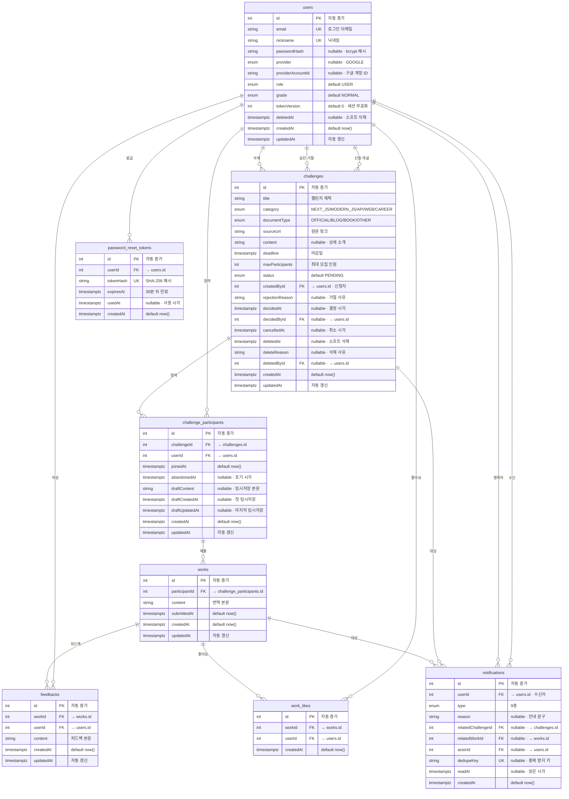

# 독스루 ERD 8테이블 확정안

> **기본 정보**: 2026-10-23 · **8테이블 / 73컬럼 / 7 ENUM / 15 관계** · Google OAuth + 이메일 인증 · **DB 마이그레이션·이메일 인증 BE/FE 반영 완료** (Google OAuth는 기존 뼈대 유지)

## 1. 목표

Google 소셜 로그인과 이메일 회원가입을 함께 지원하고, 탈퇴·비밀번호 재설정까지 안전하게 처리하기 위해 기존 10테이블 계약을 **8테이블**로 정리한 확정안이에요.

| 병합·추가                               | 내용                                                                       |
| --------------------------------------- | -------------------------------------------------------------------------- |
| `oauth_accounts` → `users`              | `provider`·`providerAccountId` + `@@unique([provider, providerAccountId])` |
| `challenge_applications` → `challenges` | 통합 `ChallengeStatus`                                                     |
| `drafts` → `challenge_participants`     | `draftContent`·`draftCreatedAt`·`draftUpdatedAt`                           |
| `users` 확장                            | `deletedAt`(소프트 삭제) · `tokenVersion`(세션 무효화)                     |
| `password_reset_tokens` 추가            | 30분 만료 · 1회용 · SHA-256 해시 저장                                      |

**삭제**: `OAuthAccount` · `ChallengeApplication` · `Draft` 모델, `ApplicationStatus` enum
**추가**: `PasswordResetToken` 모델 (관계 1개 증가 → 15개)

## 2. 8테이블 요약

| #   | 테이블                   | 역할                                | 변경                                                    |
| --- | ------------------------ | ----------------------------------- | ------------------------------------------------------- |
| 1   | `users`                  | 계정 + Google 연결 + 탈퇴·세션 버전 | `oauth_accounts` 병합 · `deletedAt`·`tokenVersion` 추가 |
| 2   | `challenges`             | 신청 + 챌린지                       | `challenge_applications` 병합                           |
| 3   | `challenge_participants` | 참여 + 임시저장                     | `drafts` 병합                                           |
| 4   | `works`                  | 제출 작업물                         | 그대로                                                  |
| 5   | `feedbacks`              | 피드백                              | 그대로                                                  |
| 6   | `work_likes`             | 좋아요                              | 그대로                                                  |
| 7   | `notifications`          | 알림                                | 그대로                                                  |
| 8   | `password_reset_tokens`  | 비밀번호 재설정 토큰                | **신규**                                                |

```text

확정:  8테이블 / 73컬럼 / 7 ENUM


```

## 3. ERD

### 3.1 상세 ERD (컬럼 포함)



### 3.2 ERD 범례

**① 표기 안내**

| 표기        | 의미                                |
| ----------- | ----------------------------------- |
| `PK`        | 기본키                              |
| `FK`        | 외래키 — 설명의 `→` 뒤가 대상       |
| `UK`        | 단일 컬럼 UNIQUE                    |
| `UQ(a, b)`  | 복합 UNIQUE — 두 컬럼을 합쳐야 유일 |
| `IDX(a, b)` | 인덱스 — 조회 가속용                |
| `nullable`  | NULL 허용                           |
| `default …` | 기본값                              |
| `—`         | PK 외 UNIQUE 없음                   |

**② 테이블별 UNIQUE · INDEX**

| 테이블                   | UNIQUE                                                           | INDEX                                                                                                                        |
| ------------------------ | ---------------------------------------------------------------- | ---------------------------------------------------------------------------------------------------------------------------- |
| `users`                  | `UK(email)` · `UK(nickname)` · `UQ(provider, providerAccountId)` | `IDX(grade)`                                                                                                                 |
| `challenges`             | —                                                                | `IDX(status, deadline)` · `IDX(status, createdAt)` · `IDX(category, documentType)` · `IDX(createdById)` · `IDX(decidedById)` |
| `challenge_participants` | `UQ(challengeId, userId)`                                        | `IDX(userId, abandonedAt)`                                                                                                   |
| `works`                  | —                                                                | `IDX(participantId)` · `IDX(submittedAt)`                                                                                    |
| `feedbacks`              | —                                                                | `IDX(workId, createdAt)` · `IDX(userId)`                                                                                     |
| `work_likes`             | `UQ(workId, userId)`                                             | `IDX(userId)`                                                                                                                |
| `notifications`          | `UK(dedupeKey)`                                                  | `IDX(userId, readAt, createdAt)` · `IDX(relatedChallengeId)`                                                                 |
| `password_reset_tokens`  | `UK(tokenHash)`                                                  | `IDX(userId)` · `IDX(expiresAt)`                                                                                             |

**③ ENUM 값 (7종 — 변경 없음)**

| ENUM               | 값                                                                                                                                                                                         |
| ------------------ | ------------------------------------------------------------------------------------------------------------------------------------------------------------------------------------------ |
| `UserRole`         | `USER` · `ADMIN`                                                                                                                                                                           |
| `UserGrade`        | `NORMAL` · `EXPERT`                                                                                                                                                                        |
| `OAuthProvider`    | `GOOGLE`                                                                                                                                                                                   |
| `Category`         | `NEXT_JS` · `MODERN_JS` · `API` · `WEB` · `CAREER`                                                                                                                                         |
| `DocumentType`     | `OFFICIAL` · `BLOG` · `BOOK` · `OTHER`                                                                                                                                                     |
| `ChallengeStatus`  | `PENDING` → `IN_PROGRESS` → `CLOSED` · `REJECTED` · `CANCELLED`                                                                                                                            |
| `NotificationType` | `CHALLENGE_APPROVED` · `CHALLENGE_REJECTED` · `CHALLENGE_UPDATED` · `CHALLENGE_DELETED` · `WORK_ADDED` · `FEEDBACK_ADDED` · `FEEDBACK_UPDATED` · `CHALLENGE_DEADLINE` · `FEEDBACK_DELETED` |

> ERD 박스는 **컬럼·키·기본값·FK 대상**까지 보여줍니다. 복합 UNIQUE·INDEX·ENUM 값은 위 범례에 모았고, 정확한 제약 정의는 4장과 `src/prisma/contract.prisma`가 기준이에요.

## 4. 테이블 상세

### 4.1 `users`

| 컬럼                | 타입              | NULL | 키·기본값  | 설명                                  |
| ------------------- | ----------------- | :--: | ---------- | ------------------------------------- |
| `id`                | Int               |  ❌  | PK, AI     | 사용자 ID                             |
| `email`             | String            |  ❌  | **UNIQUE** | 로그인 이메일                         |
| `nickname`          | String            |  ❌  | **UNIQUE** | 닉네임                                |
| `passwordHash`      | String            |  ✅  |            | 로컬 로그인 비밀번호 해시             |
| `provider`          | OAuthProvider     |  ✅  |            | `GOOGLE` (로컬 계정은 NULL)           |
| `providerAccountId` | String            |  ✅  |            | 구글 고유 계정 ID                     |
| `role`              | UserRole          |  ❌  | `USER`     | `USER` / `ADMIN`                      |
| `grade`             | UserGrade         |  ❌  | `NORMAL`   | `NORMAL` / `EXPERT`                   |
| `tokenVersion`      | Int               |  ❌  | `0`        | JWT `ver` 클레임과 비교하는 세션 버전 |
| `deletedAt`         | TimestamptzString |  ✅  |            | 탈퇴(소프트 삭제) 일시                |
| `createdAt`         | TimestamptzString |  ❌  | `now()`    | 생성일시                              |
| `updatedAt`         | TimestamptzString |  ❌  | 자동 갱신  | 수정일시                              |

**제약**: `@@unique([provider, providerAccountId])` — 같은 구글 계정 중복 연결 방지
**인덱스**: `grade`

**관계**

- `passwordResetTokens` 1:N (`PasswordResetToken`)
- `createdChallenges` 1:N (`ChallengeCreator`)
- `decidedChallenges` 1:N (`ChallengeDecider`)
- `deletedChallenges` 1:N (`ChallengeDeleter`)
- `participations` 1:N
- `feedbacks` 1:N
- `workLikes` 1:N
- `notifications` 1:N (`NotificationReceiver`)
- `actedNotifications` 1:N (`NotificationActor`)

> Google 계정은 `oauth_accounts` 테이블 없이 `users` 두 컬럼으로 연결 정보를 보관합니다. 로컬 계정은 두 값이 모두 NULL이에요.

**탈퇴 처리**

- `deletedAt = now()`로 **소프트 삭제**하고, 로그인·조회 쿼리는 `deletedAt IS NULL`을 기본 조건으로 사용합니다.
- `email`·`nickname`은 UNIQUE·NOT NULL이라 NULL로 바꿀 수 없어서 `deleted-{id}@deleted.invalid` · `탈퇴한 사용자 {id}`로 익명화합니다.
- `passwordHash`·`provider`·`providerAccountId`는 NULL로 지우고, `tokenVersion`을 1 올려 기존 access/refresh 토큰을 즉시 무효화합니다.
- 챌린지·작업물·피드백은 보존합니다(FK `onDelete` 정책 유지).

**비밀번호 재설정**

- 요청 시 30분 만료·1회용 원문 토큰을 만들고, DB에는 SHA-256 해시만 저장합니다.
- 메일 링크에는 원문 토큰만 넣고, 확정 시 해시를 비교한 뒤 `usedAt`을 기록합니다.

### 4.2 `challenges`

신청과 챌린지를 한 행에서 처리합니다. 신청 시 `PENDING`으로 만들고, 승인하면 같은 행을 `IN_PROGRESS`로 바꿉니다.

| 컬럼              | 타입              | NULL | 키·기본값       | 설명                                     |
| ----------------- | ----------------- | :--: | --------------- | ---------------------------------------- |
| `id`              | Int               |  ❌  | PK, AI          | 신청·챌린지 통합 ID                      |
| `title`           | String            |  ❌  |                 | 챌린지 제목                              |
| `category`        | Category          |  ❌  |                 | `NEXT_JS` 등                             |
| `documentType`    | DocumentType      |  ❌  |                 | `OFFICIAL` / `BLOG` / `BOOK` / `OTHER`   |
| `sourceUrl`       | String            |  ❌  |                 | 원문 링크                                |
| `content`         | String            |  ✅  |                 | 상세 소개                                |
| `deadline`        | TimestamptzString |  ❌  |                 | 신청 시 희망 마감일, 승인 후 실제 마감일 |
| `maxParticipants` | Int               |  ❌  |                 | 최대 모집 인원                           |
| `status`          | ChallengeStatus   |  ❌  | `PENDING`       | 통합 상태                                |
| `createdById`     | Int               |  ❌  | FK → `users.id` | 신청자·개설자                            |
| `rejectionReason` | String            |  ✅  |                 | 거절 사유                                |
| `decidedAt`       | TimestamptzString |  ✅  |                 | 승인·거절 결정일시                       |
| `decidedById`     | Int               |  ✅  | FK → `users.id` | 승인·거절 관리자                         |
| `cancelledAt`     | TimestamptzString |  ✅  |                 | 신청 취소일시                            |
| `deletedAt`       | TimestamptzString |  ✅  |                 | 챌린지 소프트 삭제일시                   |
| `deleteReason`    | String            |  ✅  |                 | 삭제 사유                                |
| `deletedById`     | Int               |  ✅  | FK → `users.id` | 삭제 관리자                              |
| `createdAt`       | TimestamptzString |  ❌  | `now()`         | 생성일시                                 |
| `updatedAt`       | TimestamptzString |  ❌  | 자동 갱신       | 수정일시                                 |

**관계**

- `createdBy` N:1 `User` (`ChallengeCreator`, `onDelete: Restrict`)
- `decidedBy` N:1 `User?` (`ChallengeDecider`, `onDelete: SetNull`)
- `deletedBy` N:1 `User?` (`ChallengeDeleter`, `onDelete: SetNull`)
- `participants` 1:N
- `notifications` 1:N

**인덱스**

```text
(status, deadline)
(status, createdAt)
(category, documentType)
(createdById)
(decidedById)
```

**조회 규칙**

```sql
-- 공개 챌린지 목록: 승인된 것만
WHERE status IN ('IN_PROGRESS', 'CLOSED')
  AND deleted_at IS NULL

-- 어드민 신청 목록: 아직 챌린지가 되지 않은 것만
WHERE status IN ('PENDING', 'REJECTED', 'CANCELLED')
  AND deleted_at IS NULL
```

> ⚠️ 공개 목록에서 `status` 필터가 빠지면 승인 전 신청이 노출됩니다. 이 조건은 repository에서 반드시 지켜 주세요.

### 4.3 `challenge_participants`

| 컬럼             | 타입              | NULL | 키·기본값            | 설명                |
| ---------------- | ----------------- | :--: | -------------------- | ------------------- |
| `id`             | Int               |  ❌  | PK, AI               | 참여 ID             |
| `challengeId`    | Int               |  ❌  | FK → `challenges.id` | 참여한 챌린지       |
| `userId`         | Int               |  ❌  | FK → `users.id`      | 참여자              |
| `joinedAt`       | TimestamptzString |  ❌  | `now()`              | 참여일시            |
| `abandonedAt`    | TimestamptzString |  ✅  |                      | 포기일시            |
| `draftContent`   | String            |  ✅  |                      | 임시저장 본문       |
| `draftCreatedAt` | TimestamptzString |  ✅  |                      | 첫 임시저장일시     |
| `draftUpdatedAt` | TimestamptzString |  ✅  |                      | 마지막 임시저장일시 |
| `createdAt`      | TimestamptzString |  ❌  | `now()`              | 생성일시            |
| `updatedAt`      | TimestamptzString |  ❌  | 자동 갱신            | 수정일시            |

**제약**

- `@@unique([challengeId, userId])` — 같은 챌린지에 같은 사용자가 중복 참여하지 못함
- `@@index([userId, abandonedAt])`

**임시저장 규칙**

| 동작 | 처리                                                                               |
| ---- | ---------------------------------------------------------------------------------- |
| 저장 | `draftContent` 갱신, `draftCreatedAt`이 null이면 `now()`, `draftUpdatedAt = now()` |
| 조회 | `draftContent`가 null이면 “임시저장 없음”                                          |
| 삭제 | `draftContent = null`, `draftUpdatedAt = null` (행 삭제 없음)                      |

> `drafts` 테이블을 없애서 에디터 저장·조회가 **참여자 행 1개**만 보면 됩니다. 조인·별도 INSERT/DELETE가 사라져요.

### 4.4 `works`

| 컬럼            | 타입              | NULL | 키·기본값                        | 설명        |
| --------------- | ----------------- | :--: | -------------------------------- | ----------- |
| `id`            | Int               |  ❌  | PK, AI                           | 작업물 ID   |
| `participantId` | Int               |  ❌  | FK → `challenge_participants.id` | 제출한 참여 |
| `content`       | String            |  ❌  |                                  | 번역 본문   |
| `submittedAt`   | TimestamptzString |  ❌  | `now()`                          | 제출일시    |
| `createdAt`     | TimestamptzString |  ❌  | `now()`                          | 생성일시    |
| `updatedAt`     | TimestamptzString |  ❌  | 자동 갱신                        | 수정일시    |

**관계**: `feedbacks` 1:N · `likes` 1:N · `notifications` 1:N
**인덱스**: `participantId`, `submittedAt`

> 작업물은 **참여 1건당 여러 개** 허용합니다(D-49). `translations`처럼 챌린지와 1:1로 묶지 않아요.

### 4.5 `feedbacks`

| 컬럼        | 타입              | NULL | 키·기본값       | 설명        |
| ----------- | ----------------- | :--: | --------------- | ----------- |
| `id`        | Int               |  ❌  | PK, AI          | 피드백 ID   |
| `workId`    | Int               |  ❌  | FK → `works.id` | 대상 작업물 |
| `userId`    | Int               |  ❌  | FK → `users.id` | 작성자      |
| `content`   | String            |  ❌  |                 | 피드백 본문 |
| `createdAt` | TimestamptzString |  ❌  | `now()`         | 작성일시    |
| `updatedAt` | TimestamptzString |  ❌  | 자동 갱신       | 수정일시    |

**인덱스**: `(workId, createdAt)`, `userId`

> 작업물 하나에 피드백 여러 개가 달리는 **1:N**이라 테이블을 유지합니다.

### 4.6 `work_likes`

| 컬럼        | 타입              | NULL | 키·기본값       | 설명        |
| ----------- | ----------------- | :--: | --------------- | ----------- |
| `id`        | Int               |  ❌  | PK, AI          | 좋아요 ID   |
| `workId`    | Int               |  ❌  | FK → `works.id` | 작업물      |
| `userId`    | Int               |  ❌  | FK → `users.id` | 누른 사용자 |
| `createdAt` | TimestamptzString |  ❌  | `now()`         | 좋아요일시  |

**제약**: `@@unique([workId, userId])` — 같은 사용자가 같은 작업물에 1회만
**인덱스**: `userId`

> 좋아요는 **N:M**이라 테이블을 유지합니다. `favoriteCount`를 따로 저장하지 않아서 “카운트와 실제 행이 다르다” 문제가 없어요.

### 4.7 `notifications`

| 컬럼                 | 타입              | NULL | 키·기본값            | 설명              |
| -------------------- | ----------------- | :--: | -------------------- | ----------------- |
| `id`                 | Int               |  ❌  | PK, AI               | 알림 ID           |
| `userId`             | Int               |  ❌  | FK → `users.id`      | 수신자            |
| `type`               | NotificationType  |  ❌  |                      | 알림 종류         |
| `reason`             | String            |  ✅  |                      | 사유·안내 문구    |
| `relatedChallengeId` | Int               |  ✅  | FK → `challenges.id` | 관련 챌린지       |
| `relatedWorkId`      | Int               |  ✅  | FK → `works.id`      | 관련 작업물       |
| `actorId`            | Int               |  ✅  | FK → `users.id`      | 행위자            |
| `dedupeKey`          | String            |  ✅  | **UNIQUE**           | 중복 알림 방지 키 |
| `readAt`             | TimestamptzString |  ✅  |                      | 읽은 일시         |
| `createdAt`          | TimestamptzString |  ❌  | `now()`              | 생성일시          |

**인덱스**: `(userId, readAt, createdAt)`, `relatedChallengeId`

> `targetType` + `targetId` 같은 다형성 대신 실제 FK를 유지합니다. 챌린지·작업물이 삭제되면 알림도 함께 정리되고, 잘못된 ID가 남지 않아요.

### 4.8 `password_reset_tokens`

| 컬럼        | 타입              | NULL |    키·기본값    | 설명                     |
| ----------- | ----------------- | ---- | :-------------: | ------------------------ |
| `id`        | Int               | ❌   |     PK, AI      | 재설정 토큰 ID           |
| `userId`    | Int               | ❌   | FK → `users.id` | 대상 사용자              |
| `tokenHash` | String            | ❌   |   **UNIQUE**    | 원문 토큰의 SHA-256 해시 |
| `expiresAt` | TimestamptzString | ❌   |                 | 만료 일시 (발급 + 30분)  |
| `usedAt`    | TimestamptzString | ✅   |                 | 사용 완료 일시 (1회용)   |
| `createdAt` | TimestamptzString | ❌   |     `now()`     | 발급 일시                |

**관계**: `user` N:1 `User` (`onDelete: Cascade`)
**인덱스**: `userId`, `expiresAt`

> 원문 토큰은 **메일 링크에만** 넣고 DB에는 남기지 않아요. 링크가 유출돼도 DB만으로는 재사용할 수 없고, `usedAt`·`expiresAt`으로 1회·30분 제한을 지켜요.

## 5. 현재 → 8테이블 매핑

| 현재 테이블              | 8테이블                  | 처리                                                    |
| ------------------------ | ------------------------ | ------------------------------------------------------- |
| `users`                  | `users`                  | Google 연결 컬럼 흡수 + `deletedAt`·`tokenVersion` 추가 |
| `oauth_accounts`         | `users`                  | **병합** (`provider`·`providerAccountId`)               |
| `challenge_applications` | `challenges`             | 병합                                                    |
| `challenges`             | `challenges`             | 신청 필드 흡수                                          |
| `challenge_participants` | `challenge_participants` | 그대로                                                  |
| `drafts`                 | `challenge_participants` | `draft*` 컬럼으로 병합                                  |
| `works`                  | `works`                  | 그대로                                                  |
| `feedbacks`              | `feedbacks`              | 그대로                                                  |
| `work_likes`             | `work_likes`             | 그대로                                                  |
| `notifications`          | `notifications`          | 그대로                                                  |
| —                        | `password_reset_tokens`  | **신규**                                                |

### 5.1 OAuth 필드 매핑

| 현재 `oauth_accounts` | 8테이블 `users`                       |
| --------------------- | ------------------------------------- |
| `userId`              | 기존 `users.id`                       |
| `provider`            | `provider`                            |
| `providerAccountId`   | `providerAccountId`                   |
| `id`·`createdAt`      | 제거 (연결 이력은 별도 보관하지 않음) |

### 5.2 신청 필드 매핑

| 현재 `challenge_applications` | 8테이블 `challenges`                                               |
| ----------------------------- | ------------------------------------------------------------------ |
| `userId`                      | `createdById`                                                      |
| `desiredDeadline`             | `deadline`                                                         |
| `status`                      | `status` (`PENDING`/`REJECTED`/`CANCELLED`/`IN_PROGRESS`/`CLOSED`) |
| `rejectionReason`             | `rejectionReason`                                                  |
| `decidedAt`                   | `decidedAt`                                                        |
| `decidedById`                 | `decidedById`                                                      |
| `cancelledAt`                 | `cancelledAt`                                                      |
| `sourceApplicationId`         | 제거 (행 자체가 신청·챌린지)                                       |

### 5.3 임시저장 필드 매핑

| 현재 `drafts`   | 8테이블 `challenge_participants` |
| --------------- | -------------------------------- |
| `participantId` | 기존 `challenge_participants.id` |
| `content`       | `draftContent`                   |
| `createdAt`     | `draftCreatedAt`                 |
| `updatedAt`     | `draftUpdatedAt`                 |

## 6. 상태 전이

```text
PENDING ──승인──▶ IN_PROGRESS ──마감──▶ CLOSED
   │
   ├──거절──▶ REJECTED
   └──취소──▶ CANCELLED
```

| 현재 상태     | 이벤트      | 다음 상태                   | 기록                                          |
| ------------- | ----------- | --------------------------- | --------------------------------------------- |
| `PENDING`     | 관리자 승인 | `IN_PROGRESS`               | `decidedAt`, `decidedById`                    |
| `PENDING`     | 관리자 거절 | `REJECTED`                  | `rejectionReason`, `decidedAt`, `decidedById` |
| `PENDING`     | 신청자 취소 | `CANCELLED`                 | `cancelledAt`                                 |
| `IN_PROGRESS` | 마감        | `CLOSED`                    | `updatedAt`                                   |
| `IN_PROGRESS` | 관리자 삭제 | `IN_PROGRESS` + `deletedAt` | `deleteReason`, `deletedById`                 |

> 상태 전이는 DB CHECK로 강제하지 않고 service에서 검증합니다. 대신 **공개 목록 필터**와 **전이 가드**를 테스트로 고정해 주세요.
>
> DB enum 값 순서는 기존 `IN_PROGRESS`·`CLOSED` 뒤에 `PENDING`·`REJECTED`·`CANCELLED`를 append했어요(Postgres enum append-only). 화면 표시 순서와는 무관합니다.

## 7. 인덱스·제약

| 테이블                   | 제약·인덱스                                                                                           | 이유                                 |
| ------------------------ | ----------------------------------------------------------------------------------------------------- | ------------------------------------ |
| `users`                  | `email` UNIQUE, `nickname` UNIQUE, `(provider, providerAccountId)` UNIQUE, `grade`                    | 로그인·중복 가입·구글 중복 연결 방지 |
| `challenges`             | `(status, deadline)`, `(status, createdAt)`, `(category, documentType)`, `createdById`, `decidedById` | 목록·필터·어드민                     |
| `challenge_participants` | `(challengeId, userId)` UNIQUE, `(userId, abandonedAt)`                                               | 중복 참여 방지·내 참여 목록          |
| `works`                  | `participantId`, `submittedAt`                                                                        | 내 작업물·최신순                     |
| `feedbacks`              | `(workId, createdAt)`, `userId`                                                                       | 작업물별 피드백·내 피드백            |
| `work_likes`             | `(workId, userId)` UNIQUE, `userId`                                                                   | 1인 1회·내 좋아요                    |
| `notifications`          | `(userId, readAt, createdAt)`, `relatedChallengeId`, `dedupeKey` UNIQUE                               | 알림 목록·중복 방지                  |
| `password_reset_tokens`  | `tokenHash` UNIQUE, `userId`, `expiresAt`                                                             | 해시 1회용·만료 조회                 |

## 8. API 계약 영향

**API 44 ops → 48 ops로 늘어납니다.** 기존 44개는 유지하고, 인증 4개를 추가해요 (35 paths).

| API 그룹                                                     | 8테이블에서의 처리                                                         |
| ------------------------------------------------------------ | -------------------------------------------------------------------------- |
| `POST /auth/signup`                                          | `users`에 로컬 계정 생성 (`passwordHash`), `tokenVersion = 0`              |
| `POST /auth/login`                                           | `deletedAt IS NULL` + `passwordHash` 비교 후 JWT `ver = tokenVersion` 발급 |
| `PATCH /auth/me`                                             | `nickname`·`password` 수정. 비밀번호 변경 시 `tokenVersion` 증가           |
| `DELETE /auth/me`                                            | `deletedAt`·익명화·`tokenVersion` 증가 (소프트 삭제)                       |
| `POST /auth/password-reset/request`                          | `password_reset_tokens`에 해시·`expiresAt` 저장, 메일 발송                 |
| `POST /auth/password-reset/confirm`                          | 해시·만료·`usedAt` 검증 후 `passwordHash` 교체·`tokenVersion` 증가         |
| `GET /auth/google`·`/auth/google/callback`                   | `users.provider`·`providerAccountId`로 연결 조회·생성                      |
| `POST /challenge-applications`                               | `challenges`에 `status = PENDING` INSERT                                   |
| `GET /challenge-applications/me`                             | `challenges`에서 `createdById = 나` 조회                                   |
| `GET /challenge-applications/me/{applicationId}`             | `challenges.id`로 조회. 승인 건은 같은 행이 챌린지                         |
| `DELETE /challenge-applications/me/{applicationId}`          | `PENDING`일 때 `status = CANCELLED`                                        |
| `GET /admin/challenge-applications`                          | `PENDING`·`REJECTED`·`CANCELLED` 조회                                      |
| `POST /admin/challenge-applications/{applicationId}/approve` | 같은 행을 `IN_PROGRESS`로 UPDATE                                           |
| `POST /admin/challenge-applications/{applicationId}/reject`  | 같은 행을 `REJECTED`로 UPDATE                                              |
| `GET /admin/challenges`                                      | `IN_PROGRESS`·`CLOSED` 조회                                                |
| `PUT/GET/DELETE /challenges/{challengeId}/drafts/me`         | `challenge_participants.draft*` 읽기·쓰기                                  |
| `works`·`feedbacks`·`work_likes`·`notifications`             | 기존 테이블 그대로                                                         |

> ⚠️ `{applicationId}`는 8테이블에서도 **`challenges.id`와 같은 값**으로 다뤄집니다. 승인된 기존 건은 챌린지 ID를 유지하고, 미승인 건은 마이그레이션 시 새 ID가 부여될 수 있어요.

## 9. 마이그레이션

### 10.1 7테이블 (적용 완료)

1. **백업** — `pg_dump` (적용 전 DB 0건)
2. **1단계** — `ChallengeStatus`에 `PENDING`·`REJECTED`·`CANCELLED` 추가
   - Postgres는 같은 트랜잭션에서 새 enum 값을 사용할 수 없어서 먼저 커밋
3. **2단계** — 새 컬럼 추가 → 기존 데이터 이관 → 기존 테이블·컬럼 drop
   - `users.provider`·`providerAccountId`
   - `challenge_participants.draft*`
   - `challenges.rejectionReason`·`decidedAt`·`decidedById`·`cancelledAt`
   - `oauth_accounts`·`challenge_applications`·`drafts` drop
4. **검증** — 7테이블·65컬럼·7 ENUM, `migration:status` Up to date

### 10.2 8테이블 (적용 완료)

1. `users`에 `deletedAt`(nullable)·`tokenVersion`(default 0) 컬럼 추가
2. `password_reset_tokens` 테이블 생성 (`userId` FK, `tokenHash` UNIQUE)
3. `pnpm migration:plan` → 생성된 마이그레이션 검토 → `pnpm db:migrate`
4. **검증** — 8테이블·73컬럼·7 ENUM·15 관계, `migration:status` **Up to date** ✅

> 적용 전 백업: `~/Desktop/기록/독스루/DB 백업/postgres_before_8tables_20261023.dump` (418KB).
> 기존 행은 `tokenVersion = 0`, `deletedAt = NULL`로 채워졌어요.

## 11. 결정 기록

| 결정                          | 채택     | 반려한 대안             | 이유                                                    |
| ----------------------------- | -------- | ----------------------- | ------------------------------------------------------- |
| `oauth_accounts` 병합         | ✅       | 테이블 유지             | Google + 로컬 계정을 한 행에서 관리 — 1:N 확장 불필요   |
| `drafts` 병합                 | ✅       | `drafts` 유지           | 1:1이고 에디터 저장·조회가 핫패스                       |
| `challenge_applications` 병합 | ✅       | 신청 테이블 유지        | 승인 시 복사 단계 제거, 테이블 1개 감소                 |
| `feedbacks` 유지              | ✅       | `works`에 병합          | 1:N이라 피드백이 하나만 남음                            |
| `work_likes` 유지             | ✅       | `works`에 JSON 병합     | N:M·1인 1회·`likedByMe` 보장                            |
| 알림 FK 유지                  | ✅       | `targetType`/`targetId` | 다형성은 FK 무결성이 약함                               |
| 세션 무효화 `tokenVersion`    | ✅ (3-B) | 토큰 블랙리스트         | DB 1컬럼으로 전 기기 로그아웃·비밀번호 변경을 즉시 반영 |
| 탈퇴 = 소프트 삭제            | ✅       | 하드 삭제               | 챌린지·작업물·피드백 FK 보존, 개인정보만 익명화         |
| 비밀번호 재설정 토큰 해시     | ✅       | 원문 저장               | DB 유출 시 링크 재사용 방지, 1회용·30분                 |
| 메일 콘솔 fallback            | ✅       | SES 즉시 도입           | 자격 증명 없이 개발 가능, `MAIL_PROVIDER=ses`로 전환    |
